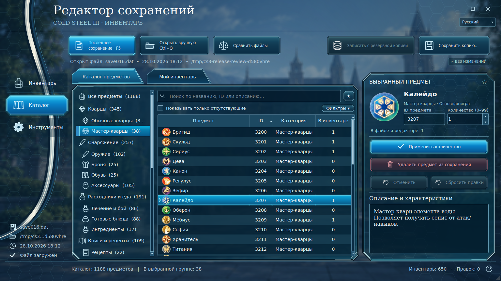
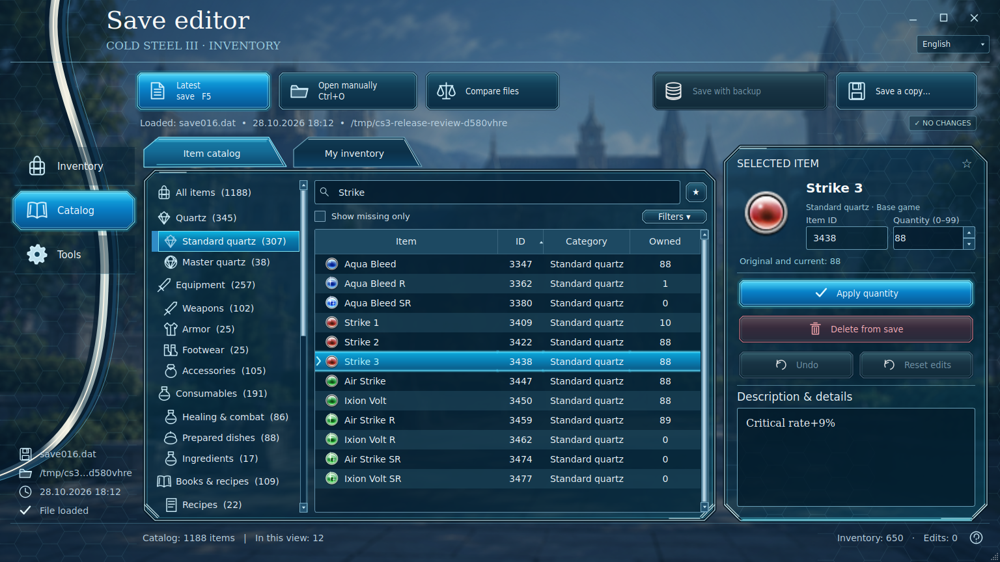
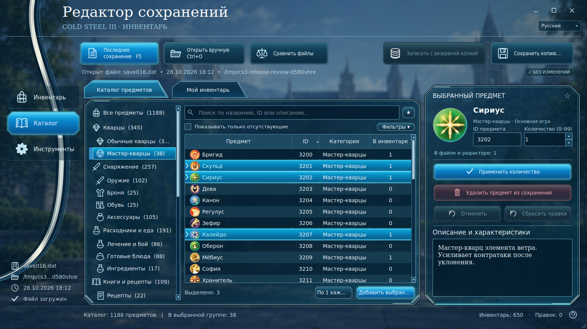

<div align="center">

# Cold Steel III Inventory Editor v7.9.4

**Unofficial save inventory editor for _The Legend of Heroes: Trails of Cold Steel III_**
**Неофициальный редактор инвентаря сохранений для _The Legend of Heroes: Trails of Cold Steel III_**


[](LICENSE)

**[Русский](#русский) · [English](#english) · [Скриншоты / Screenshots](#скриншоты--screenshots)**

</div>

## Скриншоты / Screenshots

**Русский интерфейс · Qt / Russian UI · Qt**

<p align="center">
  
</p>

**English UI · Qt / Английский интерфейс · Qt**

<p align="center">
  
</p>

<details>
<summary><strong>Multi-select / Множественный выбор — ещё один скриншот</strong></summary>

<p align="center">
  
</p>

</details>

> Screenshots show the actual application with a temporary copy of the owner’s save and locally available game data. Available item names and icons depend on the user's game installation.
> На скриншотах показана настоящая программа с временной копией сохранения владельца. Доступные названия и значки зависят от игровых файлов пользователя.

---

## Русский

**Cold Steel III Inventory Editor** позволяет просматривать инвентарь и изменять количество предметов в файлах сохранений Windows-версии _Trails of Cold Steel III_. Версия 7.9.4 использует новый игровой интерфейс на PySide6 с русским и английским языками.

### Возможности

- Добавление и удаление предметов, изменение количества **от 1 до 99**.
- **Массовое добавление:** выбери несколько строк через **Ctrl** или **Shift**, укажи количество и примени его ко всем выбранным предметам.
- Поиск по названию и ID, сортировка столбцов, категории предметов: оружие, броня, кварцы, рецепты и другие.
- Автоматический поиск последнего совместимого сохранения `saveXXX.dat` и ручное открытие файла.
- Сохранение изменённой копии или перезапись с резервным копированием, а также отмена правок.
- Автоматическое сканирование игровых таблиц `.tbl`, включая поддерживаемые DLC.
- Встроены 115 оригинальных игровых PNG с проверкой контрольных сумм; для неподтверждённой иконки показывается её отсутствие.
- Переключение **Русский / English** без перезапуска, избранное и просмотр всех правок перед записью.

### Установка и запуск

**Готовый EXE (рекомендуется):** открой раздел **Releases** справа на странице репозитория, скачай архив с Windows-версией, распакуй и запусти `CS3_Inventory_Editor.exe` (название может отличаться в зависимости от сборки). Устанавливать Python для такого EXE не нужно.

**Запуск из исходников:** установи [Python 3.10+](https://www.python.org/downloads/), скачай исходный код, распакуй его и запусти `Запустить.bat`. Для ручного запуска: `python -m pip install -r requirements.txt`, затем `python qt_window.py`. Старый Tk-интерфейс остаётся в `app.py` для совместимости.

### Как пользоваться

1. **Закрой игру** и сделай резервную копию исходного сохранения.
2. Запусти редактор: он попробует найти игру, игровые таблицы и последнее сохранение. При необходимости выбери их вручную.
3. Выбери категорию, найди один или несколько предметов и укажи количество.
4. Нажми **«Добавить / применить количество»** или **«Добавить выбранные предметы»**.
5. Сначала используй **«Сохранить копию…»**, а затем проверь результат в игре.

**Горячие клавиши:** `Ctrl+O` — открыть сохранение, `Ctrl+F` — поиск, `F5` — последнее сохранение, `Ctrl+S` — сохранить копию.


### Где находятся сохранения и как открыть их вручную

**Стандартная папка сохранений Windows (Steam / GOG / Epic, если игра использует обычный путь):**

```text
%USERPROFILE%\Saved Games\FALCOM\ed8_psv3
```

1. Нажми **Win + R**, вставь путь выше и нажми **Enter**. Можно также вставить его в адресную строку Проводника.
2. Найди нужный файл **`saveXXX.dat`** (например, `save016.dat`). Не выбирай изображения `thumbXXX.bmp` — это миниатюры сохранений.
3. В редакторе нажми **«Открыть вручную»** или **Ctrl+O** и выбери `.dat`.
4. Перед изменением скопируй оригинальный `.dat` в безопасное место. После редактирования сначала используй **«Сохранить копию…»**, а затем проверь её загрузку в игре.

> Если папка не находится, проверь, создано ли хотя бы одно сохранение в игре. При перенаправлении системной папки **Saved Games** или использовании альтернативной версии игры расположение может отличаться. Автопоиск редактора также учитывает перенаправленную папку Windows и ранее выбранную вручную папку.

### Язык предметов и DLC

Интерфейс программы переведён на русский и английский. **Тексты самих игровых предметов не включены в публичный репозиторий**: редактор читает названия и описания из таблиц установленной игры. Для русских названий при английской установке нужна собственная русская таблица предметов или отдельно установленный пользовательский языковой пакет. Если перевода нет, программа обозначает отсутствующий язык вместо выдуманного перевода.


Для английских названий и описаний используй **«Инструменты → Импорт английского каталога»**. Если рядом с основной английской таблицей лежат `t_magic.tbl` и `t_itemhelp.tbl`, редактор восстанавливает шесть недостающих описаний кварцев. Импорт базовой таблицы сохраняет ранее загруженные DLC. ID 249 не предлагается для добавления; ранее добавленную запись можно удалить через «Мой инвентарь».

Настройки предыдущей версии копируются в отдельный совместимый профиль при первом запуске. Исходный профиль старого редактора и файлы игры не меняются. Папка профиля сохраняет прежнее имя `CS3InventoryEditor_BETA` для совместимости с тестовыми версиями.

### Безопасность

> **Важно:** редактор предназначен для сохранений совместимой PC-версии _Cold Steel III_. Всегда сохраняй оригинальные файлы. Изменённые сохранения проверялись автоматическими тестами, но совместимость с любым состоянием игры не гарантируется. Изменение некоторых сюжетных предметов может повлиять на прохождение.

---

## English

**Cold Steel III Inventory Editor** is an unofficial Windows desktop tool for browsing and editing item quantities in _Trails of Cold Steel III_ save files. Version 7.9.4 provides the new PySide6 game-style interface in Russian and English.

### Features

- Add or remove items and set item quantities **from 1 to 99**.
- **Batch editing:** use **Ctrl** or **Shift** to select multiple items and apply one quantity in a single operation.
- Search by item name or ID, sort columns, and browse categories such as weapons, armor, quartz, recipes and more.
- Detect the newest compatible `saveXXX.dat` automatically or select a save manually.
- Save an edited copy, overwrite with backup, and undo changes.
- Scan installed `.tbl` item data, including supported DLC tables.
- Includes 115 original game PNG assets with hash verification. Unverified missing art is left unavailable.
- Switch between **Russian / English** without restarting; use favorites and review all edits before saving.

### Installation

**Windows EXE (recommended):** use the repository's **Releases** section, download the Windows build, extract it, and launch `CS3_Inventory_Editor.exe` (the filename may vary by build). Python is not required for the standalone EXE.

**From source:** install [Python 3.10+](https://www.python.org/downloads/), download and extract the source code, then run `Запустить.bat`. To launch manually, run `python -m pip install -r requirements.txt`, then `python qt_window.py`. The legacy Tk interface remains available in `app.py`.

### How to use

1. **Close the game** and back up your original save file.
2. Open the editor. It will attempt to locate the game tables and latest save; you can select either manually.
3. Browse a category, find one or more items, and enter the desired quantity.
4. Click **Add / update quantity** or **Add selected items**.
5. Choose **Save a copy** first and test the edited save in game.

**Shortcuts:** `Ctrl+O` open a save · `Ctrl+F` search · `F5` latest save · `Ctrl+S` save a copy.


### Save file location and manual selection

**Default Windows save folder (Steam / GOG / Epic, when using the standard game save path):**

```text
%USERPROFILE%\Saved Games\FALCOM\ed8_psv3
```

1. Press **Win + R**, paste the path above, and press **Enter**. You can also paste it into File Explorer's address bar.
2. Locate the **`saveXXX.dat`** file you want (for example, `save016.dat`). Do not select `thumbXXX.bmp` files — those are save thumbnails.
3. In the editor, click **Open manually** or press **Ctrl+O**, then choose the `.dat` file.
4. Back up the original `.dat` before editing. Start with **Save a copy…**, and verify the edited save loads correctly in game.

> If the folder does not exist, first make sure the game has created at least one save. A redirected Windows **Saved Games** folder or another game edition may use a different location. The editor also checks redirected Windows save folders and the last folder you selected manually.

### Item names, descriptions and localization

The **application UI** supports Russian and English. The public repository intentionally **does not contain game item databases or translated game text**. Item names and descriptions are loaded from the user's own installed game tables. Russian item text on an English installation requires a separately obtained Russian-localized table or a user-provided language pack. Missing translations are labelled rather than invented.


Use **Tools → Import English catalog** for original English names and descriptions. Keep English `t_magic.tbl` and `t_itemhelp.tbl` beside the item table to recover six missing quartz descriptions. Base imports retain previously loaded DLC. ID 249 is excluded from adding; an existing entry can be removed through My inventory.

Settings from the previous editor are copied once into a separate compatible profile. The old profile and game files remain unchanged. The profile keeps its historical `CS3InventoryEditor_BETA` folder name for compatibility with preview builds.

### Save safety

> **Important:** Only compatible _Cold Steel III_ PC save files are supported. Keep backups of your originals. Edited saves have been tested offline, but compatibility with every game state is not guaranteed. Modifying progression-related items may have unintended effects.

---

## For developers / Для разработчиков

Install development dependencies and run tests:

```bash
python -m pip install -r requirements-dev.txt
python -m pytest -q
```

The repository also includes GitHub Actions workflows for automated tests and Windows EXE builds. See [CONTRIBUTING.md](CONTRIBUTING.md), [CHANGELOG.md](CHANGELOG.md) and [SECURITY.md](SECURITY.md).

## License, attribution & disclaimer / Лицензия и отказ от ответственности

The editor's original source code is released under the [MIT License](LICENSE). This **does not** grant rights to the game, its artwork, texts, translations or trademarks. The public source release excludes game tables, item databases and users' saves. Bundled original PNG artwork is attributed in `icons/original/sources.json`. Screenshot examples illustrate the application UI.

Исходный код редактора распространяется по [лицензии MIT](LICENSE). Лицензия **не распространяется** на игру, игровые изображения, тексты, переводы и товарные знаки. Игровые таблицы, базы предметов и пользовательские сохранения исключены. Источники включённых оригинальных PNG перечислены в `icons/original/sources.json`.

**Not affiliated with or endorsed by Nihon Falcom or NIS America.**
**Проект не связан с Nihon Falcom или NIS America и не поддерживается ими официально.**
